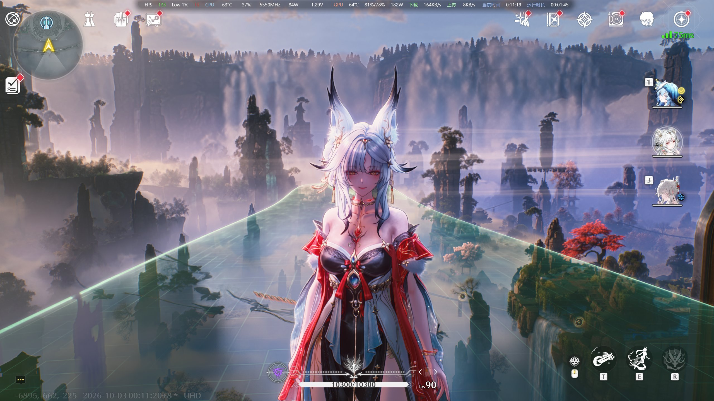

# WuwaUID — 鸣潮隐藏 UID（ReShade add-on / DX12）

[](README.md) [](README.zh-CN.md)

[](#-完全由-ai-编写)
[](#-反作弊风险未知)

[](LICENSE)
[](#五安装)
[](#五安装)
[](#一这是什么)

---

> [!CAUTION]
> ### 🔴 完全由 AI 编写
>
> **本项目的每一行代码 —— ReShade 集成、绘制指纹、运行时学习逻辑、以及这份文档本身 ——
> 都由 AI 编写，没有任何人类作者。** 没有人对代码做过正确性或安全性审查。
> 它只被「跑起来验证」过：正式版确实隐藏了 UID，`status` 文件里有对应数据
> （见 [第六节](#六验证记录)）；但它**没有**经过人工审阅。
>
> 请据此评估是否使用。运行前请自己读源码 —— 整个 add-on 就是一个 1003 行的文件，
> 每个发布产物都能由带 tag 的 CI 重新构建。

> [!WARNING]
> ### 🟠 反作弊风险：未知
>
> 鸣潮有反作弊系统。**本 add-on 是否会被检测、是否会导致封号，没有人知道。**
> 这里给不出安全答案，也没有人拿它对抗过封号潮。
>
> 能精确说明的是它**做**什么和**不做**什么：它只调用 ReShade 官方文档里的 add-on API，
> **不**修改游戏文件、**不**读取游戏内存、**不**向游戏进程写内存、**不**注入代码、
> **不**做任何 vtable hook。抑制用的返回值是官方文档明确支持的。
>
> 但 **ReShade 本身会往游戏进程里注入 DLL**，有些游戏仅凭这一点就判定为违反用户协议，
> 与那个 DLL 之后干什么无关。同类项目 WuwaTFR 的作者对同一个问题的回答只有一个词：
> **"Unknown."**
>
> **风险自负。不要用在你不舍得失去的账号上。**

## 一、这是什么

一个纯 ReShade add-on。它在 **DX12** 下通过「让某一次绘制命令不执行」来隐藏屏幕上的 UID。

从 **v2.0.0** 起，目标不再写死在二进制里，而是**运行时学出来的**。add-on 会观察游戏
绘制 UI 文本的各批绘制，把「要么几乎一直在屏幕上、要么在没有别的东西在画时出现」的
批次隐藏掉 —— UID 就是这种，按钮文字不是。因此游戏更新后**不需要重新测量指纹**，
也**没有配置文件要改**、**没有热键**。

**v2.1.0 换掉了 v2.0.0 的判据。** v2.0.0 只测量一个量 —— 某个批次占目标绘制总数的
「份额」—— 而这个测量在两个方向上都失败了：它仍然会把长时间停留的菜单文字一起隐藏，
而收紧之后 UID 就完全不再被隐藏。一个比例无法区分「一直显示」和「显示了一阵子」，
所以 v2.1.0 改为问两个互相独立的问题，一个批次只要令人信服地答对其一即可。
原理见 [第七节](#七工作原理)。



## 二、v1.0.0 的已知问题

**如果你还在用 v1.0.0，请先读这一节。** v1 能正确隐藏 UID，也从未「失灵」过，
但它有一个缺陷；这个缺陷是**用户报告**出来的，不是测试出来的：

> [!IMPORTANT]
> ### ⚪ 白框：按钮变成空白
>
> v1 在隐藏 UID 的同时，**把按钮上的文字也一起隐藏了。** 按钮的圆角底板照常绘制，
> 但叠在上面的文字没有画出来 —— 于是凡是游戏在按钮上绘制文字的界面，按钮都会变成
> **空白的白色色块**。最典型的是挑战结算界面上那两个领取按钮。
>
> 其余一切正常：UID 稳定隐藏，其他 UI 元素渲染如常，也没有崩溃。

**为什么会这样。** v1 匹配的是一条**手工测量一次、然后写死进二进制**的指纹：

```
ps=5B44B3683F03BAE3  count=156  inst=1  first=0  voff=0  indexed=1
```

外加第五个字段：索引缓冲偏移 `ibo`。这些字段里，只有 `ps`、`count` 和 `ibo`
在不同批次之间会变 —— 其余对本游戏而言是常量。如果 UID 和按钮文字是从
**同一个 UI 文本池**里分配的，它们就共享同一个 `ibo`，于是规则匹配到的是
**整个池**：UID 被隐藏，池里的每个按钮文字也一起被隐藏。

**v2.0.0 修好了一半，v2.1.0 才修完。** v2 不再匹配任何指纹。它按「在屏幕上出现的比例」
给候选批次排序，只抑制占主导的那几个。UID 画得比任何按钮文字都频繁得多；实测一次会话：
UID 批次占目标绘制总数的 **96.9%**，第二名只有 **2.7%**。

这修好的是**排序**，没修好的是**窗口** —— 下一节讲这个窗口搞坏了什么。

> [!NOTE]
> v1.0.0 仍保留在 [它的 release](../../releases/tag/v1.0.0) 和 `v1.0.0` tag 中，
> 供查阅，也供想研究「当初那条指纹是怎么测出来的」的人参考。**不建议继续使用。**

## 三、v2.0.0 的已知问题

**如果你在用 v2.0.0，UID 并没有被可靠地隐藏。** 它有两个缺陷，方向相反，
第二个是在修第一个的时候发现的。

> [!IMPORTANT]
> ### ⚪ 白框又回来了 —— 但只出现在长时间停留的菜单里
>
> v1 那个「按钮变空白」的症状复发了，只是范围更窄：菜单打开几秒之后，上面的文字
> 才会变空白。复现用例就是带两个领取按钮的挑战结算界面。

**为什么会这样。** 份额是**在一个滑动窗口上**测的。v2.0.0 的窗口是时间常数为 64 次
目标绘制的指数加权计数 —— 大约 **3.5 秒**。一个在这个窗口内每帧都被绘制的批次，
无论它在绝对意义上画得多么稀少，份额都会到 100%，所以这条门槛对「这个批次待了多久」
一无所知。菜单只要开着超过三秒左右，它的文字就会爬过 38% 这条线，跟着 UID 一起被抑制。

教训是：**比例不记得自己维持了多久。** 「最近这些绘制里，这个批次占多大比例？」
无法区分「永远每帧都画」和「最近四秒里每帧都画」。

> [!IMPORTANT]
> ### ⚪ UID 又露出来了
>
> 为了补偿而收紧份额门槛，就产生了 v2.1.0 真正的前身 —— 一个**从未发布**的内部版本。
> 它的判据是**占空比**：从某个批次的第一次绘制到最近一次绘制之间，有多大比例的帧
> 里含有绘制。门槛是 85%，并要求至少 300 次绘制。在一次实际会话里，这条门槛
> **从未被满足**。跑了一万五千帧之后，status 文件里写的是 `draws suppressed: 0`，
> UID 全程可见。

**为什么。** 三个互相独立的错误，任何一个单独就足够致命：

1. **分母用错了。** status 文件里的 "frames" 统计的是 **present 回调次数**，不是显示帧数，
   而 present 回调每次真实帧会触发不定次数 —— 两次会话里分别实测到 **2.9 倍**和 **5.7 倍**。
   游戏每真实帧只绘制一次 UID，所以一个**永久在屏幕上**的批次只能拿到约 1/2.9 ≈ **34%**。
   当时 status 里最强的候选恰好报的是 33%，正是这个算式的结果。用这个分母去卡 85%，
   只有那些「每次 present 回调里画好几遍」的批次能过线 —— 也就是菜单那种短促突发，
   而那恰恰是这条门槛本该排除的东西。

2. **同一个元素会被拆成多个批次。** UID 所用的索引池会随场景切换而被重新切分，
   所以一个屏幕元素会以一串 `ibo` 各不相同的批次出现，各自覆盖会话的一部分。
   单独判定时，每一个化身都被其他化身占据的空档稀释掉。

3. **锁定是每帧重算的**，而不是记住的。一个批次如果 span 持续增长而绘制数不增长，
   就会掉回门槛以下并被静默解锁 —— 这正是用户报告的原始症状：
   **平时看不见 UID，偶尔又会露出来。**

**v2.1.0 已修复**，所以判据现在是两个问题，而不是一个比例。

## 四、下载

每个 [release](../../releases) 只附带一个文件：

| 文件 | 大小 | 说明 |
|---|---|---|
| **`WuwaUID.addon64`** | ~235 KB | 正式版。装上即可，无需任何操作。 |

v1.0.0 的 release 里另有一个 `WuwaUID-debug-hotkeys.addon64`（二分定位工具）。
**它已经不再需要、也不再发布** —— v2 不需要人工二分。详见
[第二节](#二v100-的已知问题)。

v2.1.0 的 SHA-256：

```
0911C47B20037B18B51DD4AD624A5053494FD4870FD680973CD02283FF771592  WuwaUID.addon64
```

CI 会从带 tag 的提交重新构建，因此新构建的字节可能不同但行为一致。
**以源码为准，而不是以哈希为准。**

## 五、安装

把**一个文件**复制进 ReShade 搜索 add-on 的目录，通常就是游戏主程序所在目录：

```
<游戏目录>\Client\Binaries\Win64\
    ├── Client-Win64-Shipping.exe
    ├── dxgi.dll                 ← ReShade
    └── WuwaUID.addon64          ← 本 add-on
```

也可以直接运行 `install.bat`：它会先探测常见的 Steam / Epic / 独立安装布局，
只有都匹配不上时才询问路径。也可以显式指定目录：

```
install.bat "D:\Wuthering Waves\Wuthering Waves Game\Client\Binaries\Win64"
```

ReShade 会加载以 `.addon64` 结尾的 64 位 add-on。装好后看一眼 `ReShade.log`，
应该有这几行：

```
Searching for add-ons (*.addon, *.addon64) in '...\Binaries\Win64' ...
Loading add-on from '...\WuwaUID.addon64' ...
Registered add-on "WuwaUID" v0.0.0.0 using ReShade API version 20.
```

**不需要放 `.ini`，也不需要保留任何 `.dll`。**

## 六、验证记录

add-on 会在自己旁边写一个 **`WuwaUID.status.txt`**，大约每秒刷新两次：

```
WuwaUID v4 live status
======================
mode                : automatic (target learned at runtime, no hotkeys)
frames              : 27990
draws seen          : 14542925
draws suppressed    : 8907
  of which from .ini: 0
manual rules        : 0

--- target learning ---
target              : ps=5B44B3683F03BAE3 count=156
draws on target     : 11232
state               : locked on
bar                 : 300 draws, 20% duty, span >= 2400 frames (now)
incarnations adopted: 3
suppressing         : inst=1 first=0 voff=0 indexed=1 ibo=29339392 (locked@3280 last@6406)
suppressing         : inst=1 first=0 voff=0 indexed=1 ibo=25989888 [inherited] (locked@7077 last@12410)
suppressing         : inst=1 first=0 voff=0 indexed=1 ibo=16546048 [inherited] (locked@12777 last@16505)
suppressing         : inst=1 first=0 voff=0 indexed=1 ibo=17503232 [inherited] (locked@17275 last@27987)

candidates (bar: 300 draws, 20% duty, span >= 2400):
  [0] inst=1 first=0 voff=0 indexed=1 ibo=17503232   duty  54%  draws  5849  span 17192..27987  solo 4511  gap   3  seg 1649   <-- suppressed
  [1] inst=1 first=0 voff=0 indexed=1 ibo=29339392   duty  33%  draws  1415  span  2171..6406   solo 1414  gap   6  seg  938   <-- suppressed
  [2] inst=1 first=0 voff=0 indexed=1 ibo=25989888   duty  21%  draws  1212  span  6847..12410  solo 1141  gap 634  seg 1073   <-- suppressed
  [3] inst=1 first=0 voff=0 indexed=1 ibo=16546048   duty  23%  draws   912  span 12562..16505  solo  532  gap 728  seg  769   <-- suppressed
  [4] inst=1 first=0 voff=0 indexed=1 ibo=18212352   duty 100%  draws   170  span 26286..26455  solo    0  gap   0  seg    0
  [5] inst=1 first=0 voff=0 indexed=1 ibo=8732416    duty  24%  draws   162  span 15591..16239  solo    0  gap   7  seg  161
  [6] inst=1 first=0 voff=0 indexed=1 ibo=20349440   duty  19%  draws   158  span 23099..23922  solo    0  gap 203  seg  154

--- per-frame match count ---
  frames with 0 matches : 18603
  frames with 1 match   : 7598
  frames with 2+ matches: 1789

--- diagnostics ---
pipelines seen      : 6708 (with pixel shader: 4279)
pipeline binds      : 6297772 (PS hash resolved: 6225669)
command lists       : 64
draws w/o bound PSO : 0
```

| 看到什么 | 说明 |
|---|---|
| `state : locked on` | 至少有一个目标已选定并正在被抑制 |
| `state : warming up` | 目标绘制次数还太少，暂不判断 —— 刚进游戏的头几秒属正常 |
| `state : no candidate yet` | 当前没有批次过线，UID 处于可见状态 |
| `draws suppressed` 大于 `0` | 确实有绘制被丢掉。若这里一直是 `0`，说明什么都没被隐藏 |
| `incarnations adopted: 3` | 另有三个批次被认出是同一个屏幕元素被重新切分 —— 即上面的 `[inherited]` 行 |
| 被抑制那行的 `solo` | 该批次是**唯一**被绘制的候选的那些帧：第二判据，也是菜单永远满足不了的那条 |
| **未**被抑制的行却显示 `duty 100%` | 一次短促突发 —— 它在自己出现的每一帧都画，然后就没了。它到不了 300 次绘制，被正确忽略 |
| `draws w/o bound PSO` 不为 `0` | ReShade 没有上报管线绑定，请开 issue |
| `with pixel shader` 为 `0` | 装错版本了 |

**头几秒的可见是这套方案的代价。** 在一个批次「挣到」资格之前，什么都不会被抑制，
所以刚进游戏时 UID 会短暂露出；换场景后如果换来的是一个没见过的批次，也会短暂露出：

| 情况 | 代价 |
|---|---|
| 启动后第一次锁定 | UID 的首个批次出现后约 1100 次 present 回调 |
| 之后每次场景切换 | 新批次出现后几百次回调内被收养 —— 前提是最近 2400 次回调内有已锁定的批次活跃过 |

## 七、工作原理

全部通过 ReShade 官方文档里的 add-on API 完成。

1. **给管线上索引。** 每个新 PSO 都会触发 `addon_event::init_pipeline`。
   像素着色器字节码用 FNV-1a 哈希后存进 `PSO 句柄 → 哈希` 表。

2. **跟踪状态。** DX12 的绘制命令不携带状态，必须自己跟踪：
   `addon_event::bind_pipeline` 记录每个命令列表绑定了哪个 PSO，
   `bind_index_buffer` 记录索引缓冲偏移，`reset_command_list` 清空两者。

   > **唯一一处反直觉的地方。** 这里**不能**按 `pipeline_stage` 过滤。
   > DX12 一次调用就绑定整个 PSO，而 ReShade 并不保证给出 `pixel_shader` 位；
   > 一旦用这个掩码过滤，所有图形管线绑定都会被静默丢弃，每条绘制看起来都
   > 「没有像素着色器」。**这正是当初把第一版搞坏的那个 bug。**

3. **取指纹。** 每次 `draw` / `draw_indexed` 得到

   ```
   DrawKey { PS 哈希, 索引数, 实例数, 起始索引, 基准顶点, 是否索引绘制, ibo }
   ```

4. **选出目标。** 只有两个字段被假定为常量 —— 像素着色器哈希和索引数。其余全靠学习：

   - 每个匹配这两个字段的批次称为一个**候选**，用其余字段标识。每个候选各自累计：
     绘制次数、它出现过的帧范围、以及在这些帧里它是**唯一**被绘制候选的次数。
   - 候选只要满足**两条互相独立判据中的一条**就会被抑制，而且一旦满足，本局内就一直
     保持被抑制。两条判据都不是滑动窗口上的比例 —— 它们描述的都是批次的一生，
     所以都不会被「最近三秒发生了什么」说服或推翻。

     | 判据 | 门槛 | 含义 |
     |---|---|---|
     | **耐力** | ≥ 300 次绘制；span 至少为 `max(1200, 已历时 × 12%)` 次 present 回调且不超过 2400；其中至少 20% 的回调里含有绘制 | 这个批次在到目前为止的大部分会话里都在。12% 这一项让早期门槛不至于失真；封顶则避免一次长会话要求一个「已经存在四十分钟」的批次。 |
     | **独占** | span ≥ 600 次回调、solo 帧 ≥ 300、且 solo 帧 ≥ 该批次自身绘制的 25% | 这个批次在「同类里没有别的东西在画」的时候画。这是**快通道** —— 在录得的那次会话里它约 7 秒锁定，而单靠耐力需要 14 秒 —— 而菜单永远满足不了它：菜单只可能开在 HUD **之上**。 |

   - **为什么要两条。** 单靠耐力太慢；单靠独占则有漏洞，因为两个时间上重叠的批次
     可以在对方的空档里各自积累 solo 帧。耐力下面垫一条占空比下限，是为了不让
     「活得久但画得少」的批次仅凭 span 就过线。实测中分离度不是「勉强够用」而是
     **类别性的**：UID 的各化身拿到 532–4511 个 solo 帧，而**每一个菜单突发都恰好是 0**。

   - 同时最多抑制 **8** 个批次，并且锁定是**记住的**而不是每帧重算的。批次一旦确认就
     一直确认，直到它空闲满 36000 次回调（约七分钟游戏时间）。

   - **化身。** UID 所用的索引池会随场景切换而被重新切分，所以同一个屏幕元素会以
     新的 `ibo` 重新出现。新批次在满足以下条件时会被**收养**（无需重新挣门槛即可锁定）：
     它在某一帧是**唯一**的候选、自身已被绘制至少 60 次、且最近 2400 次回调内有
     已锁定的批次活跃过。status 文件把这些行标成 `[inherited]` 并计数。
     正是这一点让 UID 在换场景后继续保持隐藏，而不是让学习器从头开始。

   这里**完全不需要知道真实帧是什么，也刻意不去猜**。present 回调每次真实帧的触发次数
   并不固定（两个会话里分别实测到 2.9 倍和 5.7 倍），所以 status 里的 "frames" 实际上是
   回调次数。上面每一条门槛要么是回调计数、要么是绘制计数 —— **没有一条是相对于墙钟
   时间的速率**，而那正是 [v2.0.0 犯的错](#三v200-的已知问题)。

5. **抑制。** 回调返回 `true`。ReShade 官方文档原文：

   > *To prevent this command from being executed, return `true`, otherwise
   > return `false`.*

   这条绘制命令从未进入命令队列。这是官方支持的 API 行为，不是 hack。

## 八、可调参数

第七节第 4 步里的门槛是 [`src/main.cpp`](src/main.cpp) 顶部的 `constexpr`，就是留给改的：

```cpp
// 被假定为常量的两个字段
constexpr uint64_t kUidPsHash       = 0x5B44B3683F03BAE3ull;
constexpr uint32_t kUidIndexCount   = 156;

// 两条判据共用
constexpr uint64_t kMinHits         = 300;    // 任何批次的最少绘制次数
constexpr uint64_t kMinDutyPct      = 20;     // 它出现的回调里至少这么多含绘制
constexpr size_t   kMaxCandidates   = 512;    // 同时跟踪的批次数上限
constexpr size_t   kMaxTargets      = 8;      // 同时抑制的批次数上限

// 第一判据：耐力
constexpr uint64_t kMinSpanFrames   = 1200;   // 绝对下限，约 14 秒
constexpr uint64_t kMinSpanSharePct = 12;     // 或已历时的 12%，取大者
constexpr uint64_t kMaxRequiredSpan = 2400;   // 上限，约 28 秒

// 第二判据：独占
constexpr uint64_t kFastSpanFrames  = 600;    // 约 7 秒
constexpr uint64_t kMinSoloFrames   = 300;
constexpr uint64_t kMinSoloSharePct = 25;     // solo 帧 ≥ 自身绘制的 25%

// 化身收养
constexpr uint64_t kMinAdoptDraws   = 60;
constexpr uint64_t kHandoverGap     = 2400;   // 前一个化身需在此期间活跃过
constexpr uint64_t kStaleFrames     = 36000;  // 闲置约七分钟后解锁
```

（时间按每秒约 84 次 present 回调折算。）

**调低 `kMinHits` 没有用。** 试过：把录得的那次会话重放一遍，一个只画了 159 次的菜单
突发就会经独占通道蒙混过关 —— 它的 span 与一个画得少得多的 UID 化身完全重叠，
于是靠对方的空档攒够了 solo 帧。**绝对规模才靠得住，比例靠不住。**
status 文件就是反馈回路 —— 它实时打印每个候选的绘制数、span、solo 帧与占空比。

## 九、什么情况下会失效

v2.1.0 没有写死的指纹，所以「游戏更新打乱 shader 或重建 UI 文本池」不会让它失效 ——
最坏情况只是收敛慢几秒，status 里的 `ps=` 值会变。

真正会让它失效的是**问题结构本身的改变**，而不是其中常量的改变。它依赖两件事：
**UID 与按钮始终是可分离的批次**，以及**标签从不是某次回调里唯一被画的东西**。
如果游戏不再把 UID 作为独立的一批绘制，或者开始把按钮和 UID 画在同一批里，
那么再怎么看「活了多久、有没有独占过」也分不出两者。

排查顺序：

| 症状 | 先看什么 |
|---|---|
| UID 一直可见 | status 里的 `draws suppressed`。它若是 `0`，说明没有任何批次过线 —— 门槛需要放宽，或问题结构变了 |
| UID 在换场景后又露出来 | `incarnations adopted` 是否在涨。若恒为 `0`，说明新化身没被收养：前一个化身在最近 2400 次回调内不活跃了 |
| 按钮又被画成空白 | 在候选表里找 `solo` 不为 `0` 的非 UID 行 —— 那是误锁。把它的 `span / draws / solo` 附在 issue 里 |
| `draws w/o bound PSO` 不为 `0` | ReShade 没有上报管线绑定，请开 issue |

拿不准时按 **F9**：会把最近 900 次 present 回调里每次的匹配情况 dump 到
`WuwaUID.snapshot.txt` —— 每帧有几个批次匹配、以及匹配到的全部字段。

## 十、附加规则

可选：add-on 旁边的 `WuwaUID.ini` 可以**追加**固定规则，用于无条件抑制某些批次。
它只在加载时读一次，且**永远不会被写入** —— 删掉它不改变任何行为。

```ini
[WuwaUID]
Blocked=1
K0=5B44B3683F03BAE3,156,1,0,0,1
```

值的格式是 `ps,count,inst,first,voff,indexed`。注意这些是**精确指纹**，
用这种方式钉死的规则在游戏改变内存布局后就不再匹配 —— 它是逃生通道，
不是学习逻辑的替代品。

## 十一、从源码构建

需要 CMake ≥ 3.20 和 MSVC（VS 2022 或 Build Tools）。

```powershell
# 1. 取 ReShade 头文件（任意你想针对的版本）
git clone --depth 1 https://github.com/crosire/reshade.git

# 2. 配置 —— include 路径必须是 ASCII，非 ASCII 路径会导致头文件查找失败
cmake -S . -B build -G "Visual Studio 17 2022" -A x64 `
      "-DRESHADE_INCLUDE_DIR=$PWD\reshade\include"

# 3. 构建
cmake --build build --config Release

# 4. 产物
#    build\Release\WuwaUID.addon64
```

本 add-on 针对 ReShade 修订版 `aae2b7ec`（API 版本 20）构建，在 ReShade 6.8.0 上测试。

## 十二、卸载

删掉 `WuwaUID.addon64`（以及可选的 `WuwaUID.status.txt`）即可。
它不碰任何别的东西 —— 没有注册表项、没有其他目录里的文件、游戏目录里不留痕迹。

## 十三、目标是怎么找到的

这一节记录 v1 那条指纹当初是怎么测出来的。**v2 完全不需要这些** ——
保留它是因为方法本身有记录价值，而且 `v1.0.0` tag 里仍然带着那个工具。

目标是通过**二分游戏的绘制调用**逐个缩小范围找到的。候选列表有数千条，
逐条试不现实；每次砍一半则只需 `log2(n)` 步。

| 键 | 动作 |
|---|---|
| `F7` | 撤销上一次收窄（屏幕看错了时用） |
| `F8` | 重建候选表，范围重置为 `[0, 全部)` |
| `F9` | 抑制当前范围的左半部分 |
| `F10` | UID 消失了 → 保留左半 |
| `F11` | UID 还在 → 保留右半 |
| `F12` | 清除已学习规则（内置规则不受影响） |

当范围收敛到单条候选时会自动提交。它用 `log2(2115) ≈ 12` 轮收敛，
而记录的撤销深度恰好是 `12` —— 每一轮都答对了。

**两个值得记下来的失误：**

1. **第一次收敛到了错误的目标** —— `count=3`，一个三角形，不可能是 UID。
   12 轮里有一轮被看错了，而当时没有撤销功能。`F7` 就是为此而加的。

2. **每帧绘制数上限设得太紧。** 最初阈值 2.5 砍掉了太多东西；一串多字形 HUD 文本
   可能是**每个字符一次绘制**，所以合理上限要高得多（实际用了 32）。

**候选筛选条件**，供想重做这件事的人参考：出现 ≥ 3 次、`inst == 1`、
`count ∈ (0, 200000]`、每帧绘制 ≤ 32 次，按 `|每帧次数 − 1|` 升序排列 ——
一个每帧恰好绘制一次的 HUD 元素会自然排到最前面。

它测出来的指纹，也就是 v1 写死进去的那条：

```
ps=5B44B3683F03BAE3  count=156  inst=1  first=0  voff=0  indexed=1
```

156 个索引是 52 个三角形，正好对上一小串数字加其底板的几何量。

**而二分法真正搞错的地方**记录在 [第二节](#二v100-的已知问题)：
测量本身是对的，但那条指纹描述的是一**池**批次，而不是 UID 本身，
而整个流程没有任何环节会暴露这一点。**找到目标从来不是难点 ——
把它和用同样方式绘制的东西区分开才是。**

## Credits

- [ReShade](https://reshade.me/) by crosire —— 本项目的 API 基础
- [WuwaTFR](https://github.com/wuwatfr/wuthering-waves-transparency-filter-remover)
  —— 同一款游戏的同类 add-on；在梳理 ReShade DX12 事件模型时读过它的源码，
  本项目的安装布局也沿用了它

## License

[MIT](LICENSE)。本文档的英文版见 [README.md](README.md)。
